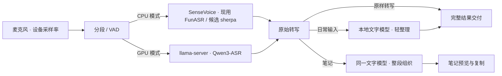

# 识别引擎选型：llama.cpp 与 sherpa-onnx

状态：2026-10-18 更新。本文保留引擎研究与技术候选，**迁移结论尚未实施**。下一版优先交付中英混合术语识别、口语整理和笔记模式；范围、顺序及验收以 [产品规划与下一版范围](product-roadmap.md) 为准。框架迁移不作为这些体验的前置条件。

## 背景

当前部署把 SenseVoice 跑在 FunASR + PyTorch（Python 子进程）上，Qwen 跑在官方 llama.cpp 上。下一版先确定支撑轻整理与笔记的文字模型；减少 Python 前置依赖、迁移 ASR 引擎等部署优化，在产品质量闭环之后，或部署成为实际阻碍时推进。本文记录三个技术问题：

1. SenseVoice 的推理引擎换成什么；
2. Qwen 是否也跟着换；
3. 未来的"口语整理/语气词消除"层用什么跑。

## 无需维护词表的术语识别与 Whisper

2026-10-18 的需求补充明确：用户希望自然说话，不能把“发现错词 → 去设置加词 → 再试”作为常态流程。选型先看空词表下的技术口述，个人词表仅补项目专名。具体实现和框架服从这个标准。

| 候选 | 本项目如何使用和比较 | 当前证据边界 |
| --- | --- | --- |
| Qwen3-ASR 1.7B | 现有本地起点；先关闭术语上下文测自然中英混说、新词和缩写 | 本机已跑通，但缺少用户真人术语录音，尚不能宣称达到质量目标 |
| Whisper large-v3-turbo | 新增质量对照候选；英文名词混在中文句子中的实际错误单列 | 官方多语言模型，是 large-v3 的加速版本；尚未在本机同一语料上对测 |
| Whisper large-v3 | 如果 turbo 的术语质量不够，作为质量优先对照，另测量化和延迟 | 官方原始实现估算显存约 10 GB，本机 6 GB 需另选量化实现或卸载调度，不能直接与整理模型全量同驻 |
| SenseVoice / Qwen3-ASR 0.6B | 保留 CPU 和资源占用基线 | 不因速度快就默认适合技术口述 |

Whisper 的模型和代码开放，可以完全本地运行。官方说明 turbo 约 809M 参数、原始实现约需 6 GB 显存，使用多语言模型才能覆盖中文；其英文 A100 相对速度不能作为本机中英混说耗时。模型卡提醒语言、口音表现有差异，也可能出现未说内容或重复。因此 Whisper 是值得实际比较的候选，而非保证所有英文音译名词都正确的答案。[官方仓库](https://github.com/openai/whisper)、[模型卡](https://github.com/openai/whisper/blob/main/model-card.md)。

Codex 桌面听写的顺畅体验可作为产品参照。查阅到的官方说明只确认语音转为输入框文字，没有公开指定底层转写模型，不能据此认定它使用开源 Whisper，或认为本地运行 Whisper 就能复现整套体验。OpenAI 的托管语音接口与开源权重也应区分：当前官方文档另列 GPT-Transcribe / GPT-Live-Transcribe，不能把这些能力视为 Whisper 的本地功能。[听写说明](https://learn.chatgpt.com/docs/prompting#use-voice-dictation)、[转写接口说明](https://developers.openai.com/api/docs/guides/transcription)。本项目继续以本地处理为前提，本轮不接云端音频上传。

先做三层消融：原始 ASR、相同 ASR 加轻整理、最后才加可选专名表。语义明确的大小写和写法可整理；纯文本模型无法重新听到音频，不能用大胆猜词隐藏 ASR 错误。不要预塞一个庞大计算机词库——提示可能诱导未说出的词，而且无法覆盖新产品名。未来若评估话题上下文或项目资料辅助，要求自动获得的上下文有明确来源、作用范围和关闭对照；这不是本轮已实现能力。

首轮真人素材须包括用户未预先给过的术语、中文口音英语、逐字母缩写、多义词（例如普通含义与 Unreal 语境中的 blueprint）以及无技术词句子。用同一份音频测未登记词错误、整体修改量、语义和等待时间，然后确定默认模型。用户已经发来的 AGV 例句是文本开发用例，不是识别准确率证据。

## 轻量优先后的 ASR 候选复核

2026-10-18 补充：文字整理是辅助工具，不能为它长期挤占 UE 所需的资源。识别模型也重新筛选，但优先复用已安装模型作基线，只增加有具体价值的候选。

| 首轮对照 | 已核实权重文件大小，十进制 | 为什么值得测 | 接入边界 |
| --- | --- | --- | --- |
| 现有 Qwen3-ASR 0.6B / 1.7B Q8 | 编码器加解码器约 1.183 / 2.807 GB | 先确定较小的 0.6B 是否已经满足真实中英口述 | 已有运行时和桌面链路 |
| Whisper large-v3-turbo | whisper.cpp Q8 约 874 MB；Q5 约 574 MB | 不同模型体系的多语言对照；先 Q8 再检查降量化的影响 | 需要独立 whisper 引擎，不能由现有 llama-server 加载 |
| Fun-ASR-Nano-2512，约 800M | 官方 encoder 约 470 MB，加 Q4 decoder 约 484 MB，共约 954 MB | 中英识别与 CPU 部署值得验证，可为 UE 留显存 | 独立 FunASR runtime；已有 Windows 预构建与常驻协议，但还需要适配生命周期和结果交付 |

这里是下载体积，**不是运行 RAM 或 VRAM**。Whisper 原版的 turbo 约 6 GB / large 约 10 GB 显存估算不适用于所有量化实现；whisper.cpp 的实际显存与延迟需要在本机测，不能从 GGUF 文件大小直接推算。权重和部署依据见 [Whisper 转换文件](https://huggingface.co/ggerganov/whisper.cpp/tree/main)、[whisper.cpp](https://github.com/ggml-org/whisper.cpp)、[Fun-ASR 官方 GGUF](https://huggingface.co/FunAudioLLM/Fun-ASR-Nano-GGUF) 和 [Fun-ASR runtime](https://github.com/QwenAudio/Fun-ASR/tree/main/runtime/llama.cpp)。Nano-2512 与多语言 MLT-Nano 是不同 checkpoint，不混用结果。

没有证据表明现有 Qwen 已经过时或必须换掉。Qwen 团队的同表测量中，Whisper large-v3 / Qwen 0.6B / Qwen 1.7B 在 AISHELL-2 的错误率分别为 5.06 / 3.15 / 2.71，WenetSpeech net 为 9.86 / 5.97 / 4.97；英文 LibriSpeech test-clean 则为 1.51 / 2.11 / 1.63。这些是中文 CER、英文 WER，是团队公开结果，不是本机量化表现，也不是未登记计算机术语的正确率。表中没有 turbo，不能将 large-v3 的成绩套给它。[Qwen3-ASR 技术报告 Table 3](https://arxiv.org/html/2601.21337v2)。

FireRedASR2-AED 约 1B+，官方明确支持中英混说，可作为上述候选仍不能解决真实错误时的第二轮质量对照；它的 Windows 部署、内存和延迟尚未验证。较大的 LLM 版本不符合当前轻量方向。[官方仓库](https://github.com/FireRedTeam/FireRedASR2S)。NVIDIA Parakeet TDT 0.6B v3 的官方语言清单不含中文，不因英文成绩或速度推荐到本项目。[模型卡](https://huggingface.co/nvidia/parakeet-tdt-0.6b-v3)。

本轮新增 ASR 工作是资料复核，尚未下载、集成或运行 Whisper / Fun-ASR / FireRed。后续仍用同一批真人录音、固定切分、空词表和关闭整理的条件对测，再分别比较较低量化、资源释放和 UE 同时工作的体验。整理模型的本机资源对比见 [口述评测](dictation-evaluation.md)。

已有 Qwen 另做了资源复测：0.6B 在一次公开两秒音频后，模型工作集约 1242 MiB、整卡显存较加载前增加约 1880 MiB；1.7B 分别约 2382 MiB、3280 MiB。这里只含识别模型进程，显存为整卡差值，不是连续峰值或每进程分配；公开短音频也不支持术语准确率结论。默认主力仍应先比较这两者的真实质量收益，避免默认同时常驻较大的 ASR 与文字模型。

## 本机现有测量

本机：Ryzen 7 7840H（8C/16T），RTX 4050 Laptop 6 GB。

| 项 | 数值 |
|---|---|
| 历史识别服务延迟（`.runtime/timings.jsonl`，n=162） | 服务处理 p50 0.454 s，p95 0.791 s；样本未区分模型 |
| 注入耗时 | p50 8 ms，p95 40 ms |
| 2 秒样例转写（2026-10-17 验收） | SenseVoice CPU 0.240–0.278 s；Qwen 0.6B 0.173 s；Qwen 1.7B 0.238 s |
| 磁盘占用 | `.venv` 1041 MB；模型 3805 MB（0.6B 1128 / 1.7B 2677）；llama.cpp 672 MB；缓存 2930 MB |

三模式共用 `asr_server.py`：SenseVoice 在 Python 内加载；Qwen 由 `llama_asr.py` 拉起 `llama-server.exe`，Python 只做 HTTP 适配与 WAV 编码。

服务计时包含重采样及 Qwen 适配调用，不包含模型加载、录音结束判定和文字交付。两秒样例是部署验收，不能用于确定术语准确率或完整等待时间；上述磁盘占用含两套 Qwen 和缓存，不是单一安装包大小。

## 引擎能力边界

两个框架都支持 CPU/GPU，差别不在硬件，而在**负载类型**：

| | llama.cpp（ggml） | sherpa-onnx（ONNX Runtime） |
|---|---|---|
| 强项 | 自回归 LLM 解码，CUDA 内核成熟 | 端侧 CPU + int8 小模型，非自回归编码器 |
| Qwen3-ASR | **官方推理路径**，GGUF Q8 | 有 ONNX 导出（社区/官方 0.6B int8），GPU 无公开对等数据 |
| SenseVoice | 主线不支持；需 FunASR 独立 runtime | 官方模型导出，int8 约 230 MB |
| 进程形态 | 子进程 + HTTP | 官方 Rust API / C API，可选择进程内或独立工作进程 |
| 附带能力 | 无 | Silero VAD、热词（Paraformer/Transducer）、标点、说话人分离、流式模型 |

当前候选分工：**SenseVoice → sherpa-onnx CPU；Qwen → llama.cpp CUDA**。是否迁移、采用哪个模型，以本项目的术语识别质量、等待时间和部署收益为依据。

## 公开基准证据

[VoicePing 跨平台基准（2026-02）](https://voiceping.net/zh/blog/research-offline-speech-transcription-benchmark/)（16 模型 × 9 引擎，只测速度不测准确率）：

| 场景 | 数据 |
|---|---|
| SenseVoice + sherpa-onnx（i5-1035G1 弱 CPU，11 s 音频） | 462 ms，RTF **0.042** |
| Qwen3-ASR 0.6B + ONNX Runtime int8（老 Android） | RTF **0.53**（勉强实时） |
| Qwen3-ASR 0.6B + 纯 C 实现（同机型 / 弱 Windows CPU） | RTF **11.28 / 1.21**（不可用 / 慢于实时） |
| Qwen3-ASR 0.6B（M4） | ONNX 8.0 tok/s vs 纯 C 5.7 tok/s |
| 同类对比：Whisper Tiny，sherpa-onnx vs whisper.cpp（Android） | sherpa 快 **51 倍** |

**局限**：没有"llama.cpp vs sherpa-onnx 跑同一 Qwen3-ASR"的公开对决；上表 Qwen 行的纯 C 实现不一定是 llama.cpp，不能直接外推。

## 决策记录

| 编号 | 决策 | 理由 | 状态 |
|---|---|---|---|
| D1 | Qwen 0.6B/1.7B 暂保留 llama.cpp | 已有可用链路；先验证技术口述质量，避免同时改变多个因素 | 本版起点 |
| D2 | SenseVoice 迁移 sherpa-onnx 为部署优化候选 | 主要收益是减少 Python 与模型依赖；速度、准确率及进程位置分别验证 | 后续候选 |
| D3 | 文字模型优先复用 llama.cpp，日常与笔记不强制同一策略 | 小模型资源可接受但本轮保真未通过；4B 成本偏大；先收窄自动清理范围并补按需释放 | 九组对比完成，尚无合格默认替代 |
| D4 | Fun-ASR-Nano 独立 runtime 纳入 CPU 对测候选 | 最新官方版本已有 Windows 预构建和常驻 `--stream` 协议；旧的逐请求启动理由不再足以排除它，但仍需独立适配 | 尚未集成，先测质量与资源 |
| D5 | 短期保留现有运行时分工 | 产品目标不要求单一框架；只有质量、延迟或安装问题才推动迁移 | 维持现状 |

产品处理路径与候选引擎：

## 专项：VAD

现状（[desktop/src/audio.rs](../desktop/src/audio.rs) 的 `Segmenter`）是能量检测：20 ms 帧 RMS 对比固定阈值 `speech_threshold = 0.008`，700 ms 静音切句。三个结构性弱点：

- 嘈杂环境噪声底高于阈值 → 连续模式切不开句；
- 轻声说话低于阈值 → 首音被切或整段丢弃；
- 换麦克风需重新调阈值（设置项 0.001–0.1 就是在兜这个）。

Silero VAD（sherpa 内置，模型约 2 MB）根据语音概率判定，可作为固定能量阈值的替代候选。噪声、轻声和键盘声上的收益需要本地录音验证；仍有概率和时长参数，不代表无需阈值。

**接入的真实工作量**（不是一行改动）：

- **硬约束：16 kHz 输入**（[sherpa-onnx#1447](https://github.com/k2-fsa/sherpa-onnx/issues/1447)）。当前采集保留设备采样率（48 kHz），需在客户端加重采样；
- 保留现有产品逻辑（200 ms 预录、尾部 150 ms、25 s 上限、静音窗口），只替换"是否语音"的判定；
- 保留现有分段规则单测，用可注入的语音判定测试状态机，另增加真实录音的 VAD 效果验证；
- 处理模型窗口与现有 20 ms 计数的差异，把重采样和推理放到采集工作线程，不直接放进麦克风回调；
- 手动长录音在 `service.rs` 另有按能量选择切块边界的逻辑，不能只替换 Segmenter 就宣称所有切分得到改善。

**注意**：700 ms 自动提交只适用于连续模式，默认手动模式等待用户结束。先固定窗口比较 VAD，再独立调整窗口。VAD 不必绑定 ASR 引擎迁移；是否接入，以真实漏收和切句问题的优先级决定。

## 专项：口语整理层

"转写 → 干净文字"是 instruct LLM 的 text-to-text 任务，sherpa-onnx 不能加载 instruct 模型做生成。因此：

- 整理层只能落在 llama.cpp（或另一 LLM 运行时）；
- 可以复用 `llama-server.exe`、GGUF 下载机制和 HTTP 协议，轻整理与笔记共用一个文字模型；ASR 与文字整理仍是不同模型，第二实例需要独立管理加载、健康状态和释放；
- 6 GB 卡上是否能同时常驻，需要测量模型权重、上下文和运行时缓冲合计的峰值，不能只根据 GGUF 文件大小推算；
- 日常输入在完整整理后一次交付；笔记在完整转写后统一整理并预览。首版不向外部应用逐字流式输入，避免扩大取消、焦点与部分交付的问题；
- 日常轻整理须先通过资源与语义验收，再考虑推荐默认；已有用户保留原样设置，连续模式首版继续原样转写。超时、失败、原文恢复与等待目标见产品规划。

## 风险与修正

| 项 | 说明 |
|---|---|
| 进程内崩溃隔离 | `catch_unwind` 只捕获可展开的 Rust panic，不能替代子进程对原生库崩溃的隔离；引擎选择与进程位置分别决策 |
| 打包与供应链 | `package-desktop.ps1` 随包分发 onnxruntime/sherpa DLL、许可清单与 SHA256；发布前核对包体积 |
| Rust 绑定 | 社区 sherpa-rs 已归档，优先评估官方 Rust API；固定库版本并校验后，通过本地库目录接入构建 |
| 热词限制 | sherpa 的热词接口属 Paraformer/Transducer 系；**SenseVoice 无热词参数**，CPU 路线要热词须换模型 |
| 候选范围 | 先验证现有模型的实际错误，再扩大候选；不因框架支持更多模型就增加维护范围 |
| 流式组合 | "流式小模型出草稿 + Qwen 出终稿"可行，但需草稿层与替换逻辑，是选项不是现成能力 |
| 量化与准确率 | 引擎和量化分别对照，重点检查技术术语、数字及混合语言，不预先认定量化无损 |

## 技术验证的顺序

| 项目 | 方法 | 通过判据 |
|---|---|---|
| 下一版产品能力 | 现有 ASR、术语表、轻整理、笔记逐项消融 | 按产品规划的准确率、原意保留与等待目标验收 |
| SenseVoice 引擎迁移 | 固定录音、切分、语言与 ITN，对比 FunASR 与 sherpa；尽可能单独比较量化 | 准确率保持，部署或资源收益明确；热态、冷启动分开记录 |
| Silero VAD 实际增益 | 固定 ASR 与静音窗口，对比噪声、轻声、键盘声录音 | 误切与漏切改善，首尾完整；之后再调整窗口 |
| 官方 Rust API 在 Windows MSVC 的构建 | 固定版本和本地库，干净环境及离线构建 | 构建可复现、下载可校验、发布包依赖完整 |
| Qwen 更换运行时 | 仅当现有路径成为瓶颈时，比较同模型同录音 | 质量保持，并有足以抵消迁移成本的实际收益 |

现有 `--asr-latency-check` 要求 24 kHz 单声道输入，只检查已配置服务的若干上传路径；16 kHz 的两秒部署样例不能直接用于该命令。它不能替代带参考文本、多样例、多轮测量的选型评测。

## 路线图衔接

- **下一版**：真实技术口述基线 → 术语表与主力 ASR → 日常轻整理 → 笔记模式 → 完整体验验收。
- **后续**：根据实际问题选择连续轻整理、VAD、CPU 迁移或安装简化，不按旧阶段编号强制推进。
- **完整去 Python**：除 SenseVoice 迁移外，还需把 Qwen 的 Python 适配迁入 Rust，调整依赖仓库文件的路径定位，并补齐原生库打包。按需模型下载的收益独立计算，不与引擎迁移混为一项。

## 参考

- [VoicePing 离线转写基准（2026-02）](https://voiceping.net/zh/blog/research-offline-speech-transcription-benchmark/)
- [sherpa-onnx：Qwen3-ASR 0.6B int8 模型 PR](https://github.com/k2-fsa/sherpa-onnx/pull/3409)
- [sherpa-onnx VAD 采样率 issue](https://github.com/k2-fsa/sherpa-onnx/issues/1447)
- [SenseVoiceSmall-GGUF（FunAudioLLM）](https://huggingface.co/FunAudioLLM/SenseVoiceSmall-GGUF)
- [FunASR llama.cpp runtime](https://github.com/modelscope/FunASR/tree/main/runtime/llama.cpp)
- [sherpa-onnx 官方 Rust 示例](https://github.com/k2-fsa/sherpa-onnx/tree/master/rust-api-examples)
- [sherpa-rs 归档与迁移说明](https://github.com/thewh1teagle/sherpa-rs)
- [Rust catch_unwind 的边界](https://doc.rust-lang.org/std/panic/fn.catch_unwind.html)
- [产品规划与下一版范围](product-roadmap.md)
- 本仓库：[模型部署](qwen-llama-desktop.md)、[悬浮窗设计](desktop-design.md)、[客户端说明](../desktop/README.md)
