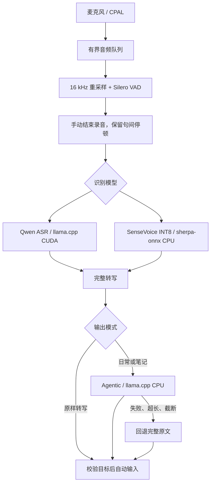

# 原生录音、识别与整理

2026-10-18，v0.4.0。当前主流程不启动 Python，不依赖 `.venv`、FunASR 或 PyTorch。旧实验文件保留供复现。

## 数据流



## 人声检测与停止方式

采用 [sherpa-onnx 的 Silero 模型](https://k2-fsa.github.io/sherpa/onnx/vad/silero-vad.html)，模型文件 643,854 字节；官方 Rust API 与共享原生库固定为 1.13.8。概率阈值 0.5，最短人声 128 ms，CPU 单线程。没有前置 RMS 音量门限，因此低音量不会仅因低于旧阈值被丢弃。RMS 现在只用于界面音量和离线消融比较。

录音回调只做单声道转换并送到 64 项有界队列；重采样、模型推理与分段在工作线程执行。队列溢出明确报错取消，避免悄悄漏音。采样率转换使用带低通滤波的原生重采样器；正常停止排空已接受的回调和滤波尾部。

默认、日常输入、笔记都手动结束。VAD 只决定首尾，首音前保留 400 ms，尾部保留约 250 ms，内部停顿和低概率片段不删掉。长手动录音在结束后切为至多 25 秒的识别请求，拼接全部转写后整理一次。音频缓存上限约 256 MiB，达到后明确取消，避免无限增长。

停顿提交是原样转写的可选项，默认关闭。启用后约 700 ms 停顿提交一段；长时间不停顿按约 25 秒分段，手动停止仍交付最后的尾段。日常和笔记不受这个偏好影响。

VAD 不改变音频中的噪声，也不能保证所有极短词、自然轻声都检出。效果验证应包含真实麦克风和环境；合成降低音量只能说明摆脱固定音量门限的收益。

## 模型管理与资源

- `audio.rs` / `vad.rs`：录音期间加载 Silero，停止后释放检测实例。内部原生片段缓冲定期释放，应用保存的完整录音不受影响。
- `runtime.rs` / `sensevoice.rs`：一次选择一个 ASR。SenseVoice INT8 在宿主内执行；Qwen 使用现有 Q8 + BF16 权重及 llama.cpp CUDA 参数。
- `llama.rs`：llama.cpp 子进程使用独立随机端口和令牌，只绑定本机回环。Windows JobObject 负责退出清理，停止不按进程名或公共端口杀进程。
- `text.rs`：Agentic 使用 CPU 4 线程、4096 上下文、0 GPU 层；按需加载，空闲 60 秒卸载。整理与笔记保留作者原生协议，没有增加按示例匹配的纠错规则。
- `service.rs`：串联识别和文字整理，保留完整原文，检查取消并记录阶段耗时。失败不以半段输出冒充完整结果。
- `main.rs` / `native.rs`：控制录音、目标校验与自动输入。笔记调试窗口是可选显示，最近结果可手动查看。

模型下载固定版本与 SHA256，先写临时文件，校验后替换。打开状态界面不会触发下载，也不会把整理模型一直留在内存。

## 可复现验证

```powershell
cargo test --manifest-path desktop/Cargo.toml --locked
./desktop/target/release/local-voice-desktop.exe --vad-check outputs/native-vad-check.json
./desktop/target/release/local-voice-desktop.exe --native-smoke tests/fixtures/ascend-01219.wav outputs/native-smoke.json
```

VAD 报告包含模型加载和推理时间、实时率、进程 CPU 时间与采样内存峰值；首轮增量包含运行库初始化，不等同于模型权重大小。后续样例会复用分配器内存，不能将后续更小的增量单独作为资源承诺。

消融对照保留旧的 20 ms RMS ≥ 0.008 判定，只用于报告。对照项目包括正常公开语音、降低 24/36 dB、静音、白噪声、50/100 Hz 干扰；另将同段语音间隔 5 秒，验证手动录音保留停顿而连续模式分段。检测时长包含模型的短延续时间，不是词准确率。

原生回环报告验证 SenseVoice → Qwen 0.6B → SenseVoice、Agentic 日常整理、模型切换与停止。不会读写用户输入框、采集麦克风或连接旧 Python 服务。

## 本机实测（2026-10-18）

Release 构建的 `outputs/native-vad-check.json`：

| 输入 | Silero 检出时长 | 旧 RMS 检出时长 | VAD 推理耗时 |
| --- | ---: | ---: | ---: |
| 2 秒公开语音 | 1.696 秒 | 1.660 秒 | 6.79 ms |
| 同段语音降低 24 dB | 1.664 秒 | 0.180 秒 | 8.52 ms |
| 同段语音降低 36 dB | 0 秒 | 0 秒 | 6.75 ms |
| 5 秒静音 | 0 秒 | 0 秒 | 14.96 ms |
| 5 秒稳定白噪声 | 0 秒 | 5 秒 | 15.52 ms |
| 5 秒工频干扰 | 0 秒 | 5 秒 | 14.94 ms |

首轮含原生运行库初始化的工作集增量 **23.6 MiB**，采样峰值 **35.3 MiB**（整个无界面检查进程），加载 **89.6 ms**。后续模型加载约 7–9 ms。这里仅测 VAD，ASR 和 Agentic 另占内存；不能把 629 KiB 权重理解为运行内存。

两次语音中间隔 5 秒：手动模式输出一段完整 9 秒录音；可选连续模式输出两段，末段已保留。以上结果支持替换旧音量门限，但极低音量仍漏检，不代表自然轻声准确率或所有噪声场景表现。

`outputs/native-smoke.json` 的原生模型回环通过：2 秒录音，SenseVoice 识别约 0.09–0.10 秒，Qwen 0.6B 约 0.25 秒；Agentic 首次含校验和加载约 3.19 秒，已加载时约 0.31 秒。成功验证模型切换与停止。样例很短且内容不完整，这些耗时不代表长笔记体验，也不证明整理质量；当前 1.7B 日常模型未在此次检查中重复加载。
